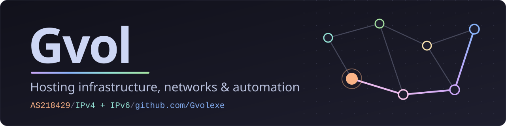
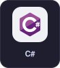
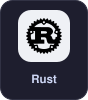
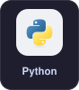
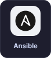
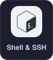
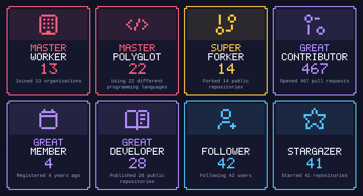

  

# 💫 About Me:
🛠️ I work at [Novacloud](https://novacloud-hosting.com), [Galenius Nodes](https://www.galeniusnodes.com/) and [MellonLab](https://mellonlab.org/) 
🌍 I run [AS218429](https://bgp.tools/as/218429), my own network 
🖥️ I focus on hosting infrastructure, networks and automation 
🎓 I am currently studying Business Administration

## 🌐 Socials:
    

# 💻 Tech Stack:

  
  
  
  
  
  
  
  
  

## 🏗️ Infrastructure:

  
  
  
  
  
  

🖥️ Proxmox VE clusters and VMs, provisioned with Ansible, with guest IP pools and bridged networking 
☁️ Cloudflare Workers host the geofeed and network website; GitHub Actions validates and deploys the geofeed

**🌍 [AS218429](https://bgp.tools/as/218429) · my network** 
   
Backbone for Ruxora and Galenius Nodes, announced over BGP on IPv4 and IPv6

**🧭 DNS & addressing** 
  
Authoritative and reverse zones on Technitium, with reverse DNS delegated through RIPE

**🛠️ Network & server tools** 
    
syncgeo pulls prefix data from RIPEstat to build the geofeed; each tool is described under [Projects](#-projects)

## 🚀 Projects:
**🌍 ASN tools**

- 🧭 **[syncgeo](https://github.com/ASN218429/scripts)**   Dependency-free terminal workbench: finds the prefixes RIPEstat sees, lets you assign and split their location blocks, validates them and writes RFC 8805 and JSON. Splits change locations, never BGP announcements
- 📡 **[geofeed](https://github.com/ASN218429/geofeed)**    The public RFC 8805 geofeed and network JSON, served at [cdn.as218429.net](https://cdn.as218429.net)
- 🌐 **[website](https://github.com/ASN218429/website)**   The AS218429 network website, with operator contacts and registry and geofeed links

**🧰 Server tools**

- 🔧 **[GvolTools](https://github.com/Gvolexe/GvolTools)**  CLI tools for SSH-managed servers: host inventory, hardening and audits, key management, DNS/TLS checks and backups

**🎨 Side projects**

- 🌾 **[Replanish](https://github.com/Gvolexe/ReplanishEnchantment)**  Minecraft plugin and mod: harvest a mature crop with a Replanish hoe and it replants itself
- 🤖 **[RevTickCalculator](https://github.com/Gvolexe/RevTickCalculator)**  Encoder tick calculator for FTC and FGC robots, written with Georgemech

# 📊 GitHub activity

### 🏆 Achievements
<picture>
  <source media="(max-width: 600px)" srcset="assets/activity-badges-mobile.svg">
  
</picture> 
Refreshed daily by GitHub Actions with gh-metrics/metrics. The contribution calendar covers the past year.

### ✍️ Random Dev Quote

