  

# 💫 About Me:
🛠️ I work at [Novacloud](https://novacloud-hosting.com), [Galenius Nodes](https://www.galeniusnodes.com/) and [MellonLab](https://mellonlab.org/) 
🌍 I run [AS218429](https://bgp.tools/as/218429): BGP over IPv4 and IPv6, RIPE reverse DNS and Technitium zones. It is the backbone behind Ruxora and Galenius Nodes 
🗺️ I build the AS218429 tools: [syncgeo](https://github.com/ASN218429/scripts), the [geofeed](https://github.com/ASN218429/geofeed) and the [network website](https://github.com/ASN218429/website) 
🖥️ I focus on hosting infrastructure, networks and automation 
🎓 I am currently studying Business Administration

## 🌐 Socials:
    

# 💻 Tech Stack:
        

## 🏗️ Infrastructure:
                

- 🖥️ **Proxmox VE** clusters and VMs, provisioned with Ansible, with guest IP pools and bridged networking
- 🌍 **AS218429**: IPv4 and IPv6 announcements, RIPE reverse DNS delegations, Technitium authoritative and reverse zones
- 🗺️ **Geofeed and network metadata**: RFC 8805 geofeed and JSON prefix metadata for the prefixes RIPEstat sees announced, managed with syncgeo and deployed to a Cloudflare Worker by GitHub Actions
- 💳 **Panels and billing**: Paymenter, Pelican, Convoy, Pterodactyl/Calagopus and WHMCS integrations
- 🐧 **Linux over SSH**: host inventory, auditing, DNS/TLS checks and backups with GvolTools

## 🚀 Projects:
**🌍 ASN tools**

- 🧭 **[syncgeo](https://github.com/ASN218429/scripts)**   Dependency-free terminal workbench for the AS218429 geofeed: finds the announced prefixes visible in RIPEstat, splits them into location blocks you assign explicitly, validates countries, regions and coverage, then writes the RFC 8805 feed with dry runs and atomic saves. Splitting never changes BGP announcements
- 📡 **[geofeed](https://github.com/ASN218429/geofeed)**    RFC 8805 CSV and JSON network and prefix metadata, served from a Cloudflare Worker at [cdn.as218429.net](https://cdn.as218429.net) after GitHub Actions validation
- 🌐 **[website](https://github.com/ASN218429/website)**   The AS218429 network website on Cloudflare Workers, with operator contacts and registry and geofeed links

**🧰 Hosting tools**

- 🔧 **[GvolTools](https://github.com/Gvolexe/GvolTools)**  CLI toolkit for SSH-managed servers: host hardening, SSH auditing, key management, DNS checks and host inventory
- 🦅 **[Pelican × Paymenter](https://github.com/Gvolexe/PelicanExtentionPaymenter)**  Paymenter extension that creates, suspends, upgrades and terminates Pelican servers, with node tags and port ranges
- 🪙 **[NowPayments](https://github.com/Gvolexe/NowPayments)**  Crypto checkout gateway for Paymenter with HMAC-signed IPN callbacks and invoice status updates

**🎨 Side projects**

- 🌾 **[Replanish](https://github.com/Gvolexe/ReplanishEnchantment)**  Minecraft plugin and mod: harvest a mature crop with a Replanish hoe and it replants itself
- 🤖 **[RevTickCalculator](https://github.com/Gvolexe/RevTickCalculator)**  Encoder tick calculator for FTC and FGC robots, written with Georgemech

# 📊 GitHub Stats:
  

## 🏆 GitHub Trophies

### ✍️ Random Dev Quote

### 🔝 Contribution Stats

